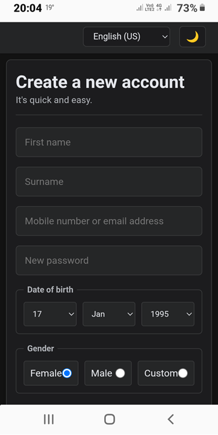
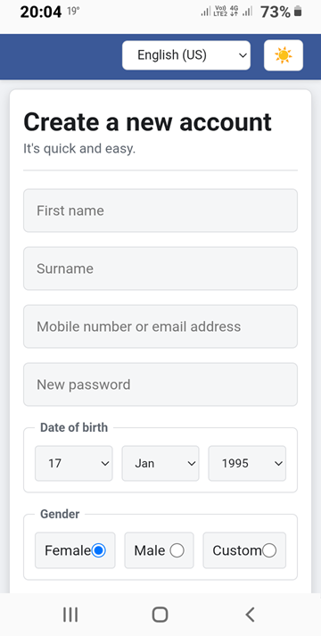
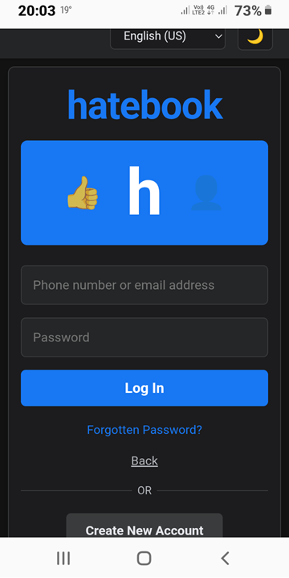

# Hatebook - Dual Implementation Prototype (Desktop & Web)

A comprehensive multi-platform prototype of the Hatebook social network interface. This project features two parallel implementations designed for educational training: a **Python Desktop Client** simulating localized state architecture, and an **Accessible Web Frontend** highlighting semantic layouts, internationalization, and adaptive user preference schemes.

## Core Project Features

### Desktop Implementation (Python & Tkinter)

- **Page I (Registration Screen):** Multi-entry profile registry featuring integrated selection comboboxes and selection parameters.

|  |  |

- **Page II (Login Screen):** Custom dark-themed panel equipped with focus control placeholder clearance actions and hidden secure string masking parameters.

|  |  |

- **Page III (Home Dashboard):** Clean interface header reading dynamic state variables alongside an aligned matrix map linking to core features.


- **In-Memory Data Bridge:** Uses system frame routers to execute navigation shifts across decoupled views while retaining user configurations safely in processing memory blocks.

### Web Implementation (HTML5, CSS3 & JavaScript)

- **Semantic & Accessible Skeleton:** Fully structured accessible fields containing semantic HTML5 elements, including explicit layout landmarks, skip links, and ARIA labels.
- **Responsive Media Query Matrix:** Smooth grid fluid adaptations scaled precisely across PC, desktop, tablet, and smartphone screens.
- **Theme Preference System:** Toggles seamlessly between Dark Mode (Default) and Light Mode via isolated CSS custom variables.
- **Dynamic i18n Engine:** Translates all structural labels and inputs placeholders instantly without page reloads across three default configurations: **EN-US** (Default), **PT-BR**, and **ES-ES**.

## Tech Stack & Architecture

- **Backend (Desktop):** Python 3.x using native graphic dependency modules (`tkinter` and `ttk`).
- **Frontend (Web):** Semantic HTML5, Vanilla JavaScript (ES6+ State Engine), and Custom Property CSS3.

### Tecnologies used

- **Python**: Python Tkinter main executable application script
- **HTML5**: Unified semantic structured elements layout skeleton
- **CSS3**: Adaptable custom theme variables and grid systems definitions
- **JavaScript**: Web state tracking, routing management, and dictionary parsing logic

## Getting Started

### 1. Running the Python Desktop App

The desktop software relies exclusively on Python native libraries. No external package installations are required.

Open your operating terminal inside the root directory and execute:

```bash
python app.py
```

### 2. Launching the Web Frontend Mockup

No remote processing frameworks or server dependencies are required to test the web interface.

- Save `index.html`, `style.css`, and `script.js` inside your localized working folder (maintain correct path mappings if using a `src/` directory).
- Open `index.html` inside any modern browser window to operate the project instantly.

[LICENSE](./LICENSE).
